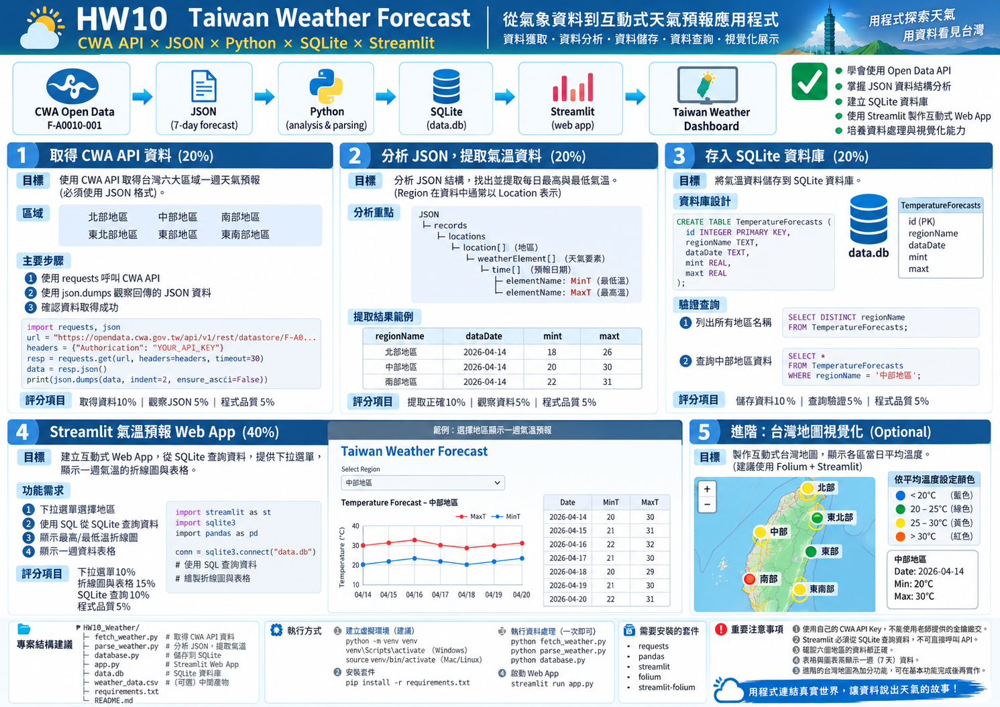
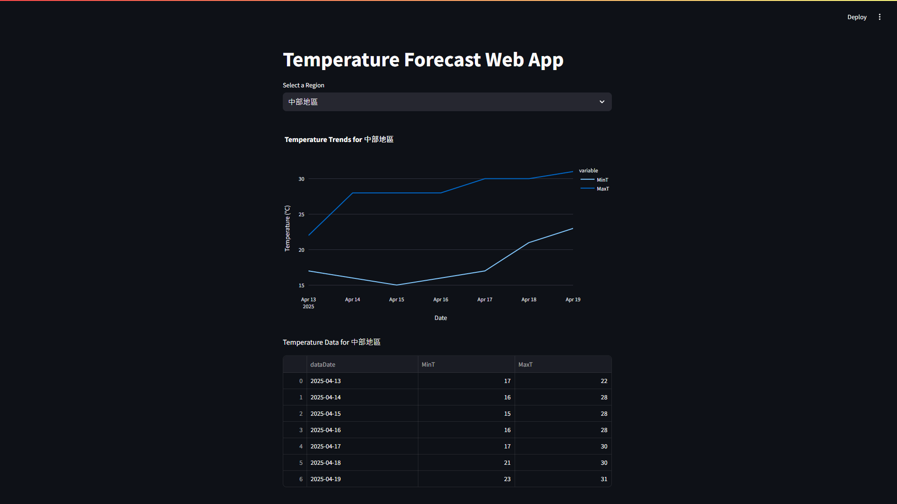
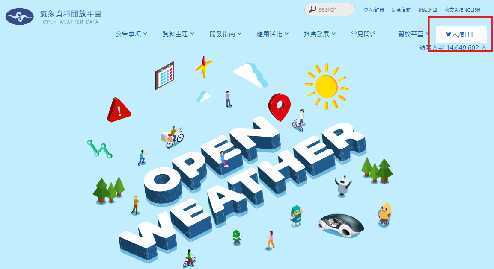
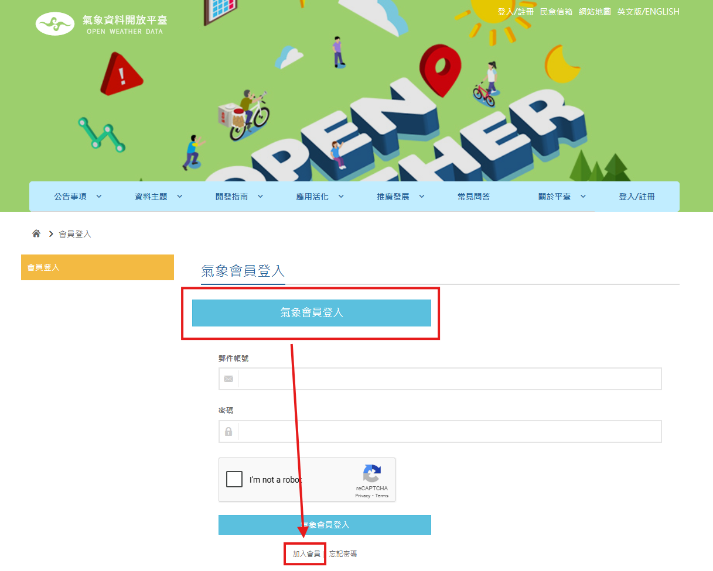
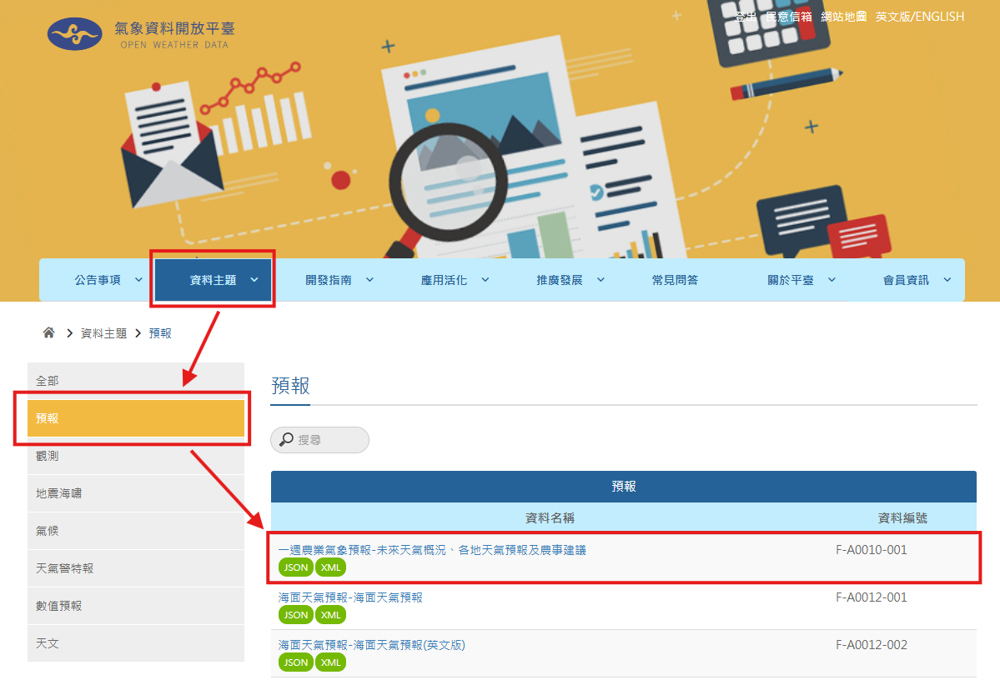
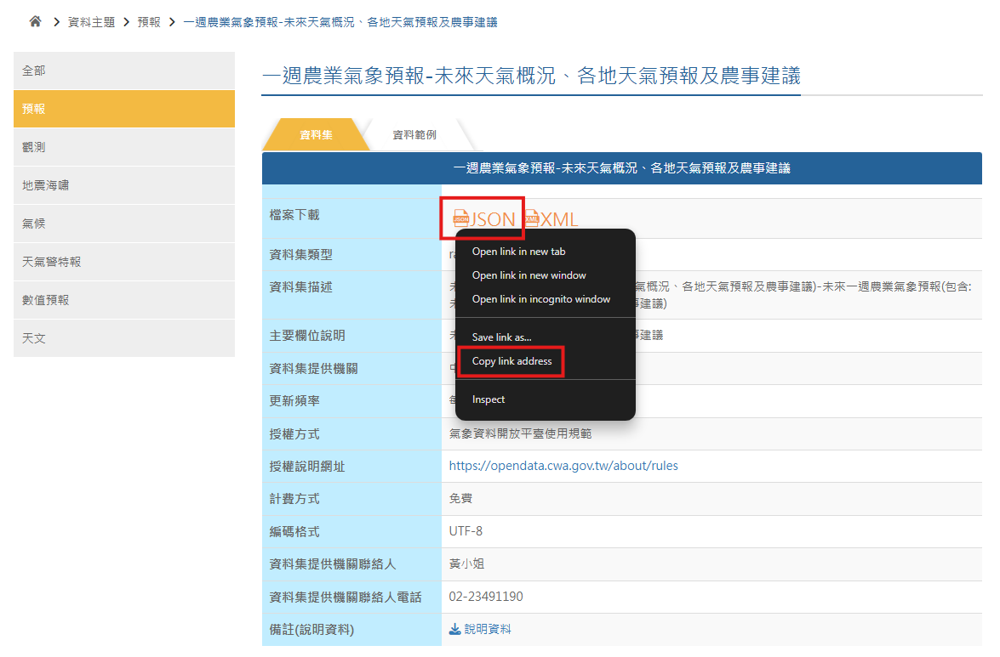
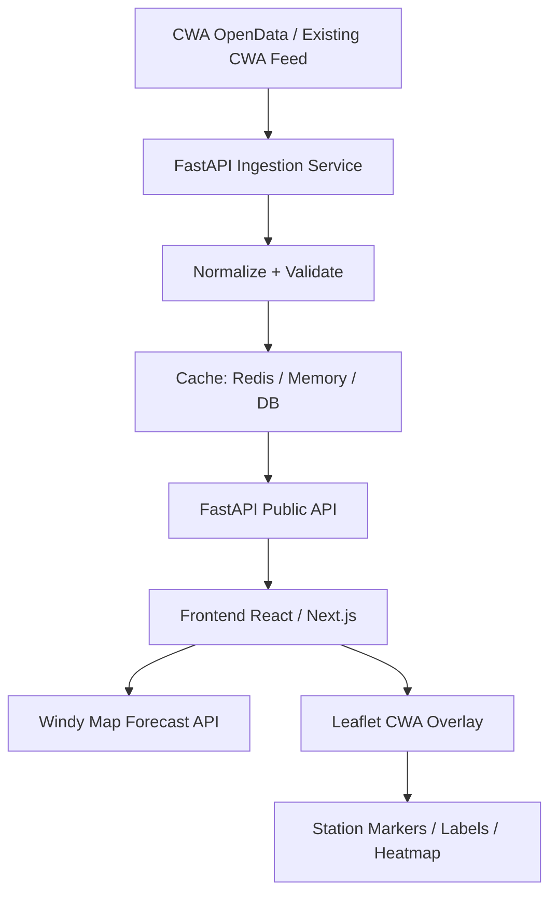

# Part 5. AI Vibe coding 天氣預測Forecast with CWA API

<aside>
💡

CWA-55FDA6D3-A43C-4AE0-BB30-E62D5F684FB2
CWA-55FDA6D3-A43C-4AE0-BB30-E62D5F684FB2

</aside>



9f2237b5-c719-407f-aed6-af545b724ed0

# Code Example

https://colab.research.google.com/drive/1k9AHE_gFvfaZt3XOaEcATTIxY60rLCr1?usp=sharing

[hw4.ipynb](hw4.ipynb)

**Using the API key provided in this example for a one-time test is permitted.** 

**However, the API key must not be used when submitting the assignment.** 

**Doing so will result in a score of 0 for that part of the assignment.**



# **Prerequisites**

### **Register for a CWA account to get the dataset URL**

1. Go to [CWA](https://opendata.cwa.gov.tw/) website and register for an account.





2. Get [dataset](https://opendata.cwa.gov.tw/dataset/forecast/F-A0010-001) url (JSON format).





---

- Preview hw4.ipynb
    
    # **HW4-1: Fetch Weather Forecast Data**
    
    - Use the CWA API to fetch weather data for each region of Taiwan over a week.
    - You must use the API that returns data in `JSON format`.
    - The regions include:
        - 北部地區
        - 中部地區
        - 南部地區
        - 東北部地區
        - 東部地區
        - 東南部地區
    
    # **HW4-2: Analyze the Fetched Data**
    
    - Analyze the data to locate the Daily `Max Temperatures` and `Min Temperatures` .
    - You can do this `manually` or use `ChatGPT` for help.
    - Note that `Region` is referred to as `Location` in the dataset.
    - After analyzing, you will locate the information you need.
    
    # **HW4-3: Save the Temperature Data to SQLite Database**
    
    - Create a SQLite database to store the temperature data.
    - The database should include a table with the following columns:
        - `id`: Primary key
        - `regionName`: Region name
        - `dataDate`: Date of the forecast
        - `MaxT`: Maximum temperature
        - `MinT`: Minimum temperature
        
        
        
    - After inserting the data, verify that it is stored correctly.
        - List all region names.
        - List the temperature data for the 中部地區.
    
    # **HW4-4: Implement the Temperature Forecast Viewer (Streamlit)**
    
    - Create a Streamlit app to visualize the temperature data.
    - Allow users to select a region from a dropdown menu and view the temperature forecast for that region.
        
        
        
    - The app `must` use SQL to query the data from the SQLite database.
    - Include both a `line chart` and a `table` to display the temperature data over the week.
        
        
        
        
        
    

**HW10作業說明與評分標準
HW10-1 獲取天氣預報資料 (20%)
目的**
使用 CWA API 獲取台灣北部、中部、南部、東北部、東部及東南部地區一週的天氣預報資料（必須是 JSON 格式）。
**方法**
1. 使用 Requests 套件調用 CWA API，獲取天氣預報資料。
2. 使用 json.dumps 觀察獲得的資料
**評分比重**
• 調用 CWA API 獲取天氣預報資料（10%）
• 觀察獲得的資料（5%）
• 程式碼結構與可讀性（5%）
**HW10-2 分析資料，提取最高與最低氣溫的資料 (20%)
目的**
分析天氣預報資料的 JSON 格式，找出最高與最低氣溫的資料位置，並提取出來。
**方法**
1. 使用 ChatGPT 或手動分析資料
2. 使用 json.dumps 觀察提取的資料
**評分比重**
• 找出並提取最高與最低氣溫的資料（10%）
• 觀察提取的資料（5%）
• 程式碼結構與可讀性（5%）
**HW10-3 將氣溫資料儲存到 SQLite3 資料庫 (20%)
目的**
將氣溫資料儲存到 SQLite3 資料庫，以便後續查詢。
**方法**
1. 建立 SQLite3 資料庫，取名為 "data.db"
2. 創建資料庫 Table，取名為 "TemperatureForecasts"
3. 將氣溫資料存到資料庫，**資料欄位必須包含**：
    ◦ 主鍵（id）
    ◦ 地區名稱（regionName）
    ◦ 時間（dataDate）
    ◦ 最低氣溫（mint）
    ◦ 最高氣溫（maxt）
4. 從資料庫查詢以下資料，來檢查資料是否正確被存入資料庫：
    ◦ 列出所有地區名稱
    ◦ 列出中部地區的氣溫資料
**評分比重**
• 將氣溫資料儲存到 SQLite3 資料庫（10%）
• 檢查資料是否正確被存入資料庫（5%）
• 程式碼結構與可讀性（5%）
**資料庫欄位範例
HW10-4 實作氣溫預報 Web App (40%)
目的**
製作一個氣溫預報 Web App 來視覺化氣溫資料。
**方法**
1. 使用 Streamlit 建立 Web App
2. 提供下拉選單，讓使用者選擇地區並查看該地區的氣溫預報
3. 必須從 SQLite3 資料庫查詢資料
4. 使用折線圖與表格來顯示一週的氣溫資料
**評分比重**
• 下拉選單功能（10%）
• 折線圖與表格（15%）
• 從 SQLite 資料庫查詢資料（10%）
• 程式碼結構與可讀性（5%）
**下拉選單範例
折線圖範例
表格範例**====complete prompt step by step =============
To complete this project (fetching 7-day weather forecast data for Taiwan's regions from the CWA API, parsing it, saving to CSV, and displaying it on an interactive Streamlit web app with a Taiwan map in a left-right layout), here are the sequential prompts that would guide an AI assistant (like me) to build it step by step. These are based on the conversation history and logical progression. Each prompt builds on the previous one, assuming the AI has access to the workspace and tools.
**1. Initial Setup and Data Fetching**
**Prompt:**
i want to 獲取天氣預報資料
使用 CWA API 獲取台灣北部、中部、南部、東北部、東部及東南部地區一週的天氣預報資料（必須是 JSON 格式）。
方法
使用 Requests 套件調用 CWA API，獲取天氣預報資料。
使用 json.dumps 觀察獲得的資料
評分比重
調用 CWA API 獲取天氣預報資料（10%）
觀察獲得的資料（5%）
程式碼結構與可讀性（5%）
(This sets up the Python environment, installs requests/pandas, and creates a script to fetch and parse the data from the CWA API for the specified regions, using json.dumps to observe the JSON output.)
**2. Providing the Base Code**
**Prompt:**
[Provide the Python code snippet for weather.py, as in the conversation.]
(This refines the script to correctly parse the API response for regional data, handle SSL issues, and save to CSV.)
**3. Saving Output to Specific CSV**
**Prompt:**
save the output the weather_data.csv
(This updates the script to save the DataFrame to "weather_data.csv" instead of the default filename.)
**4. Building the Streamlit Web App with Map**
**Prompt:**
i want to display these data on streamlit, but i need a dynamic web with taiwan map such as https://www.cwa.gov.tw/V8/C/W/OBS_Temp.html, please suggest me how to do it
(This installs streamlit/folium, creates app.py with an interactive map using Folium markers for regions, a date selector, and displays the data table.)
**5. Adjusting Layout**
**Prompt:**
i want left-right layout
(This modifies app.py to use Streamlit columns for a side-by-side layout: map on the left, table on the right.)
**Additional Notes**
• **Execution Steps:** After each prompt, the AI would run the code (e.g., via terminal) to validate and ensure it works.
• **Dependencies:** The AI would handle package installations (requests, pandas, streamlit, folium) and environment setup as needed.
• **Validation:** After substantive changes, the AI would run tests (e.g., execute the script, check for errors, run the Streamlit app) and iterate if issues arise.
• **Completeness:** These prompts cover the full project from data fetching to web deployment. If any step fails (e.g., API issues), the AI would debug and fix (e.g., handle SSL, adjust parsing).
• **Enhancements:** If you want more features (e.g., choropleth maps with GeoJSON, weather icons, or real-time updates), additional prompts could be added, but these suffice for the core requirements.
If you run these prompts in sequence with an AI, it should produce the complete project. Let me know if you need refinements or more details!===== all in one prompt =========Create a complete Python project to fetch 7-day weather forecast data for Taiwan's northern, central, southern, northeastern, eastern, and southeastern regions using the CWA API (specifically the F-A0010-001 endpoint for agricultural weather forecasts), parse the JSON response to extract temperature data (min and max), save it to a CSV file named "weather_data.csv", and build an interactive Streamlit web app with a left-right layout featuring a Folium-based Taiwan map where regions are marked with colored circles based on average temperature (blue <20°C, green 20-25°C, yellow 25-30°C, red >30°C), a date selector dropdown to filter data dynamically, and a data table on the right side showing the selected date's temperatures; ensure the app handles SSL verification issues, uses approximate region coordinates for markers, and includes popups with region details; set up the Python virtual environment, install necessary packages (requests, pandas, streamlit, folium), validate the code by running it to fetch and display data, and make the app runnable via Streamlit.**附件**
• [image.png (192.4 KB)](https://lms2020.nchu.edu.tw/filedownload/2646780)

1. 2. 使用 json.dumps 觀察獲得的資料1. 使用 Requests 套件調用 CWA API，獲取天氣預報資料。
- • 調用 CWA API 獲取天氣預報資料（10%）
- • 觀察獲得的資料（5%）
- • 程式碼結構與可讀性（5%）
1. 1. 使用 ChatGPT 或手動分析資料
2. 2. 使用 json.dumps 觀察提取的資料
- • 找出並提取最高與最低氣溫的資料（10%）
- • 觀察提取的資料（5%）
- • 程式碼結構與可讀性（5%）
1. 1. 建立 SQLite3 資料庫，取名為 "data.db"
2. 2. 創建資料庫 Table，取名為 "TemperatureForecasts"
3. 3. 將氣溫資料存到資料庫，**資料欄位必須包含**：
    - ◦ 主鍵（id）
    - ◦ 地區名稱（regionName）
    - ◦ 時間（dataDate）
    - ◦ 最低氣溫（mint）
    - ◦ 最高氣溫（maxt）
- 
- 
- 
- 
- 
1. 4. 從資料庫查詢以下資料，來檢查資料是否正確被存入資料庫：
    - ◦ 列出所有地區名稱
    - ◦ 列出中部地區的氣溫資料
- 
- 
- • 將氣溫資料儲存到 SQLite3 資料庫（10%）
- • 檢查資料是否正確被存入資料庫（5%）
- • 程式碼結構與可讀性（5%）


1. 1. 使用 Streamlit 建立 Web App
2. 2. 提供下拉選單，讓使用者選擇地區並查看該地區的氣溫預報
3. 3. 必須從 SQLite3 資料庫查詢資料
4. 4. 使用折線圖與表格來顯示一週的氣溫資料
- • 下拉選單功能（10%）
- • 折線圖與表格（15%）
- • 從 SQLite 資料庫查詢資料（10%）
- • 程式碼結構與可讀性（5%）


- • **Execution Steps:** After each prompt, the AI would run the code (e.g., via terminal) to validate and ensure it works.
- • **Dependencies:** The AI would handle package installations (requests, pandas, streamlit, folium) and environment setup as needed.
- • **Validation:** After substantive changes, the AI would run tests (e.g., execute the script, check for errors, run the Streamlit app) and iterate if issues arise.
- • **Completeness:** These prompts cover the full project from data fetching to web deployment. If any step fails (e.g., API issues), the AI would debug and fix (e.g., handle SSL, adjust parsing).
- • **Enhancements:** If you want more features (e.g., choropleth maps with GeoJSON, weather icons, or real-time updates), additional prompts could be added, but these suffice for the core requirements.


- •
    
    [image.png (192.4 KB)](https://lms2020.nchu.edu.tw/filedownload/2646780)
    

```
Create a complete Python project to fetch 7-day weather forecast data for Taiwan's
 northern, central, southern, northeastern, eastern, and southeastern regions using
  the CWA API (specifically the F-A0010-001 endpoint for agricultural weather 
  forecasts), parse the JSON response to extract temperature data (min and max), 
  save it to a CSV file named "weather_data.csv", and build an interactive Streamlit 
  web app with a left-right layout featuring a Folium-based Taiwan map where regions
   are marked with colored circles based on average temperature (blue <20°C, green 
   20-25°C, yellow 25-30°C, red >30°C), a date selector dropdown to filter data 
   dynamically, and a data table on the right side showing the selected date's 
   temperatures; ensure the app handles SSL verification issues, uses approximate 
   region coordinates for markers, and includes popups with region details; set 
   up the Python virtual environment, install necessary packages (requests, pandas,
    streamlit, folium), validate the code by running it to fetch and display data, 
    and make the app runnable via Streamlit.
```

CWA-55FDA6D3-A43C-4AE0-BB30-E62D5F684FB2

[Design.md](http://Design.md) using windy/leaflet, data is from cwa.gov.tw

```
# Design: CWA Temperature Broadcast Visualization with Windy API

## 1. Project Overview

This project visualizes Taiwan CWA temperature broadcast / observation data on top of a Windy weather map.

The system uses:

* **CWA OpenData** as the trusted weather observation source.
* **FastAPI** as the backend API and data-normalization layer.
* **Windy Map Forecast API** as the interactive weather-map background.
* **Leaflet overlay layers** to render custom CWA temperature data on top of Windy.

Windy’s Map Forecast API is based on Leaflet 1.4.x, and Windy’s own documentation states that the Windy map object is a Leaflet map instance. This means we can use normal Leaflet features to draw our own CWA markers, labels, popups, and heatmap layers on top of the Windy map.

---

## 2. Goal

Build a real-time or near-real-time Taiwan temperature visualization system.

The first version should support:

1. Displaying a Windy map centered on Taiwan.
2. Loading latest CWA temperature observations from backend API.
3. Drawing CWA station temperatures as colored map markers.
4. Showing station name, county, town, temperature, humidity, wind, and observation time in popups.
5. Refreshing data automatically.
6. Providing a simple legend for temperature color ranges.
7. Allowing the user to switch Windy background layers, such as wind, rain, clouds, or temperature.

---

## 3. Why Windy + Leaflet

Windy should be treated as the **weather context layer**, not as the storage or rendering engine for our CWA data.

Windy gives us:

* Professional-looking weather-map background.
* Built-in weather overlays.
* Map controls.
* Forecast/weather context.
* Wind, rain, cloud, and temperature model layers.

Leaflet gives us:

* Custom station markers.
* Custom CWA temperature labels.
* Popups.
* GeoJSON support.
* Layer groups.
* Future heatmap or canvas overlays.

Windy’s documentation says the Map Forecast API lets developers customize Windy map visualizations with their own content and imagery, and that the map itself provides interactivity such as zooming, dragging, moving, and click handling.

---

## 4. Data Source

### 4.1 CWA Observation Data

The CWA automatic weather station dataset includes fields such as:

* `StationName`
* `StationId`
* `DateTime`
* `StationLatitude`
* `StationLongitude`
* `StationAltitude`
* `CountyName`
* `TownName`
* `Weather`
* `Precipitation`
* `WindDirection`
* `WindSpeed`
* `AirTemperature`
* `RelativeHumidity`
* `AirPressure`
* `PeakGustSpeed`

The dataset update frequency is every 1 hour and is published under Taiwan’s Open Government Data License, version 1.0.

### 4.2 Backend Responsibility

The frontend should not directly depend on the raw CWA format.

The backend should:

1. Fetch or receive CWA data.
2. Normalize field names.
3. Remove invalid records.
4. Convert strings to numbers.
5. Cache the latest result.
6. Expose clean JSON APIs for the frontend.

---

## 5. Architecture



---

## 6. Recommended Tech Stack

### Backend

* Python 3.11+
* FastAPI
* httpx
* Pydantic
* APScheduler or cron job
* Redis cache, optional
* PostgreSQL/PostGIS, optional for historical data

### Frontend

* Next.js or Vite + React
* Windy Map Forecast API
* Leaflet
* TypeScript
* Optional: Leaflet.markercluster
* Optional: Leaflet.heat or custom Canvas layer

---

## 7. Backend Design

### 7.1 Main Backend Modules

```text
backend/
  app/
    main.py
    config.py
    routers/
      temperature.py
      health.py
    services/
      cwa_client.py
      temperature_service.py
      cache_service.py
    schemas/
      temperature.py
    jobs/
      refresh_cwa_data.py
```

---

## 8. Backend Data Model

### 8.1 Normalized Temperature Observation

```python
from pydantic import BaseModel
from datetime import datetime

class StationTemperature(BaseModel):
    station_id: str
    station_name: str
    county: str | None = None
    town: str | None = None

    lat: float
    lon: float
    altitude_m: float | None = None

    observed_at: datetime
    temperature_c: float

    humidity_percent: float | None = None
    pressure_hpa: float | None = None
    wind_speed_mps: float | None = None
    wind_direction_deg: float | None = None
    precipitation_mm: float | None = None
    weather: str | None = None
```

---

## 9. Backend API Endpoints

### 9.1 Latest Temperature

```http
GET /api/temperature/latest
```

Returns all valid latest station observations.

Response:

```json
{
  "source": "CWA",
  "updated_at": "2026-07-02T09:00:00+08:00",
  "count": 1200,
  "stations": [
    {
      "station_id": "466920",
      "station_name": "臺北",
      "county": "臺北市",
      "town": "中正區",
      "lat": 25.0377,
      "lon": 121.5149,
      "observed_at": "2026-07-02T09:00:00+08:00",
      "temperature_c": 32.4,
      "humidity_percent": 67,
      "wind_speed_mps": 2.1
    }
  ]
}
```

### 9.2 GeoJSON Temperature Layer

```http
GET /api/temperature/geojson
```

Returns data in GeoJSON format for Leaflet.

```json
{
  "type": "FeatureCollection",
  "features": [
    {
      "type": "Feature",
      "geometry": {
        "type": "Point",
        "coordinates": [121.5149, 25.0377]
      },
      "properties": {
        "station_id": "466920",
        "station_name": "臺北",
        "temperature_c": 32.4,
        "county": "臺北市",
        "town": "中正區",
        "observed_at": "2026-07-02T09:00:00+08:00"
      }
    }
  ]
}
```

### 9.3 Station Detail

```http
GET /api/temperature/stations/{station_id}
```

Returns latest detail for one station.

### 9.4 Health Check

```http
GET /api/health
```

Response:

```json
{
  "status": "ok",
  "cwa_cache_status": "fresh",
  "latest_cwa_time": "2026-07-02T09:00:00+08:00"
}
```

---

## 10. Data Validation Rules

Backend should remove or ignore records when:

1. Latitude or longitude is missing.
2. Temperature is missing.
3. Temperature cannot be parsed as number.
4. Temperature is outside a reasonable range, for example `< -20°C` or `> 50°C`.
5. Station ID is missing.
6. Observation time is invalid.

Use configurable invalid-value rules because CWA datasets may encode missing values differently depending on product.

Example:

```python
INVALID_VALUES = {"", "X", "NA", "null", None, "-99", "-999"}

def parse_float(value):
    if value in INVALID_VALUES:
        return None
    try:
        return float(value)
    except ValueError:
        return None
```

---

## 11. Frontend Design

### 11.1 Frontend Structure

```text
frontend/
  src/
    components/
      WindyMap.tsx
      TemperatureLayer.tsx
      TemperatureLegend.tsx
      StationPopup.tsx
      LayerControlPanel.tsx
    lib/
      windyLoader.ts
      cwaApi.ts
      colorScale.ts
    types/
      temperature.ts
```

---

## 12. Windy Map Initialization

Windy’s hello-world tutorial requires loading Leaflet first, then loading Windy’s `libBoot.js`. The application must contain a `div` where Windy is mounted, and `windyInit(options, callback)` is used to initialize the API.

Example:

```html
<script src="https://unpkg.com/leaflet@1.4.0/dist/leaflet.js"></script>
<script src="https://api.windy.com/assets/map-forecast/libBoot.js"></script>

<div id="windy"></div>
```

```js
const options = {
  key: WINDY_API_KEY,
  lat: 23.7,
  lon: 121.0,
  zoom: 7,
  overlay: "wind",
  verbose: true
};

windyInit(options, windyAPI => {
  const { map, store } = windyAPI;

  store.set("overlay", "wind");

  // Add CWA layer here
});
```

---

## 13. Windy Layer Control

Windy map parameters such as `overlay`, `level`, `timestamp`, `product`, and particle animation are controlled through `windyAPI.store`. The API supports `.get()`, `.set()`, and `.getAllowed()` for controlling these parameters.

Recommended default:

```js
store.set("overlay", "wind");
store.set("particlesAnim", "on");
```

Useful overlay options:

```js
const overlays = [
  "wind",
  "temp",
  "rain",
  "clouds"
];
```

Important design choice:

* Windy `temp` layer = Windy/model temperature visualization.
* CWA overlay = actual CWA station observation layer.

Do not confuse these two.

---

## 14. CWA Temperature Layer

### 14.1 Marker Layer

Use a Leaflet `LayerGroup` for station markers.

```js
let cwaLayer = L.layerGroup().addTo(map);

async function loadCwaTemperature() {
  const res = await fetch("/api/temperature/latest");
  const data = await res.json();

  cwaLayer.clearLayers();

  data.stations.forEach(station => {
    const marker = L.circleMarker([station.lat, station.lon], {
      radius: getRadius(station.temperature_c),
      fillColor: colorByTemperature(station.temperature_c),
      fillOpacity: 0.85,
      color: "#ffffff",
      weight: 1
    });

    marker.bindPopup(`
      <strong>${station.station_name}</strong><br/>
      ${station.county ?? ""} ${station.town ?? ""}<br/>
      Temperature: ${station.temperature_c}°C<br/>
      Humidity: ${station.humidity_percent ?? "-"}%<br/>
      Wind: ${station.wind_speed_mps ?? "-"} m/s<br/>
      Time: ${station.observed_at}
    `);

    marker.addTo(cwaLayer);
  });
}
```

---

## 15. Temperature Color Scale

Recommended color scale:

```ts
export function colorByTemperature(temp: number): string {
  if (temp < 10) return "#2b6cb0";
  if (temp < 15) return "#3182ce";
  if (temp < 20) return "#38a169";
  if (temp < 25) return "#ecc94b";
  if (temp < 30) return "#ed8936";
  if (temp < 35) return "#e53e3e";
  return "#9b2c2c";
}
```

Legend:

```text
< 10°C       cold
10–15°C      cool
15–20°C      mild
20–25°C      comfortable
25–30°C      warm
30–35°C      hot
> 35°C       very hot
```

---

## 16. Auto Refresh

Since CWA automatic weather station data is updated hourly, the frontend can refresh every 5–10 minutes while the backend cache refreshes hourly or slightly more often.

Recommended behavior:

```text
Backend refresh interval: every 10 minutes
Frontend refresh interval: every 5 minutes
Displayed status: latest CWA observation time
```

The frontend should always display:

```text
Last CWA update: YYYY-MM-DD HH:mm
```

---

## 17. Windy Event Handling

Windy broadcasts events such as:

* `mapChanged`
* `paramsChanged`
* `redrawFinished`
* `metricChanged`
* `uiChanged`

The `redrawFinished` event is useful when running custom tasks after Windy finishes loading and rendering data.

Example:

```js
windyAPI.broadcast.on("redrawFinished", () => {
  console.log("Windy redraw finished");
});
```

Avoid running heavy rendering logic directly on `paramsChanged`.

---

## 18. Performance Design

### 18.1 Small Dataset

If the station count is under 1,500:

* Use `L.circleMarker`.
* Use one `LayerGroup`.
* Refresh by clearing and redrawing markers.

### 18.2 Larger Dataset

If the number of points grows:

* Use marker clustering.
* Use Canvas renderer.
* Use simplified label display.
* Hide labels at low zoom levels.
* Render text labels only when zoom >= 9.

### 18.3 Heatmap Mode

For heatmap visualization:

* Start with station-point heatmap.
* Later, use gridded CWA data if available.
* Do not overclaim interpolated station data as exact ground truth.

---

## 19. UI Design

Main layout:

```text
┌─────────────────────────────────────────────┐
│ Top Bar                                     │
│ CWA Temperature Broadcast | Last update     │
├─────────────────────────────────────────────┤
│                                             │
│              Windy Map                      │
│      + CWA Temperature Overlay              │
│                                             │
├───────────────┬─────────────────────────────┤
│ Legend        │ Layer Control               │
│ Temp colors   │ Windy layer / CWA layer     │
└───────────────┴─────────────────────────────┘
```

Controls:

1. CWA overlay on/off.
2. Show station labels on/off.
3. Windy layer selector.
4. Auto refresh on/off.
5. County filter.
6. Temperature threshold filter.

---

## 20. Environment Variables

### Backend

```env
CWA_API_KEY=your_cwa_api_key
CWA_DATA_URL=your_cwa_data_url
CACHE_TTL_SECONDS=600
```

### Frontend

```env
NEXT_PUBLIC_WINDY_API_KEY=your_windy_api_key
NEXT_PUBLIC_API_BASE_URL=http://localhost:8000
```

Note:

The Windy browser key is client-visible in frontend code. The CWA key should stay server-side.

---

## 21. Security

1. Do not expose the CWA API key to the browser.
2. Restrict allowed origins on FastAPI.
3. Add rate limiting for public APIs.
4. Cache CWA data to avoid unnecessary upstream requests.
5. Do not store secrets in Git.
6. Add `.env.example`, but never commit `.env`.

---

## 22. Error Handling

### Backend Errors

If CWA fetch fails:

```json
{
  "status": "stale",
  "message": "Using cached data because CWA fetch failed.",
  "latest_cwa_time": "2026-07-02T09:00:00+08:00"
}
```

### Frontend Errors

Show friendly UI:

```text
CWA data is temporarily unavailable.
Showing the latest cached observation.
```

If Windy fails:

```text
Weather map failed to load.
CWA station data is still available in table mode.
```

---

## 23. Development Phases

### Phase 1: MVP

* FastAPI endpoint: `/api/temperature/latest`
* Windy map centered on Taiwan
* CWA station markers
* Temperature legend
* Popup detail
* Manual refresh button

### Phase 2: Dashboard

* Auto refresh
* County filter
* Station search
* Windy layer switcher
* Station label toggle
* Health check endpoint

### Phase 3: Advanced Visualization

* Heatmap mode
* Time slider
* Historical playback
* Gridded temperature layer
* Alert threshold coloring
* Mobile-friendly UI

### Phase 4: Production

* Redis cache
* Postgres/PostGIS
* API rate limiting
* Logging
* Monitoring
* Deployment to Vercel + Render/Fly.io/Railway, or self-hosted server

---

## 24. Acceptance Criteria

### MVP Acceptance Criteria

The system is complete when:

1. User can open the page and see a Windy map.
2. Map is centered on Taiwan.
3. CWA station temperature markers appear on the map.
4. Marker color changes according to temperature.
5. Clicking a marker shows station detail.
6. User can see the latest CWA observation time.
7. User can refresh CWA data.
8. Backend hides the CWA API key.
9. Frontend does not crash if CWA data is missing.
10. The project includes clear setup instructions.

---

## 25. Suggested File Structure

```text
cwa-windy-temperature/
  README.md
  design.md
  backend/
    app/
      main.py
      config.py
      routers/
        temperature.py
        health.py
      services/
        cwa_client.py
        temperature_service.py
        cache_service.py
      schemas/
        temperature.py
    requirements.txt
    .env.example
  frontend/
    src/
      components/
        WindyMap.tsx
        TemperatureLayer.tsx
        TemperatureLegend.tsx
        LayerControlPanel.tsx
      lib/
        cwaApi.ts
        colorScale.ts
        windyLoader.ts
      types/
        temperature.ts
    package.json
    .env.example
```

---

## 26. Implementation Notes

### Backend

Use FastAPI to hide upstream CWA complexity.

```python
@app.get("/api/temperature/latest")
async def get_latest_temperature():
    data = await temperature_service.get_latest()
    return data
```

### Frontend

Initialize Windy once.

Do not create multiple Windy map instances on the same page.

Keep CWA marker rendering separate from Windy initialization.

```ts
type WindyApi = {
  map: any;
  store: any;
  broadcast: any;
};
```

---

## 27. Main Technical Decision

Use this design:

```text
Windy Map Forecast API
  → provides base weather map and weather context

Leaflet custom overlay
  → renders CWA station temperature data

FastAPI
  → fetches, cleans, validates, caches, and serves CWA data
```

This is better than trying to inject CWA data into Windy’s native `temp` overlay.

---

## 28. Future Ideas

1. Compare CWA observed temperature vs Windy model temperature.
2. Show station anomalies.
3. Show top 10 hottest stations.
4. Show county average temperature.
5. Add typhoon/rain/wind overlay mode.
6. Add voice broadcast mode:

   * “Current hottest area is Tainan, 35.2°C.”
   * “Northern Taiwan is around 31–33°C.”
7. Add classroom mode:

   * Students can inspect observation data.
   * Compare station vs model.
   * Learn interpolation and weather visualization.

---

## 29. References

Windy Map Forecast API is based on Leaflet 1.4.x and allows developers to customize Windy map visualizations with their own content and imagery.

Windy initialization requires Leaflet and Windy’s `libBoot.js`, and the callback provides the Windy API object including the Leaflet map instance.

Windy map parameters such as overlay, level, timestamp, product, and particles can be controlled through `windyAPI.store`.

Windy broadcasts events such as `mapChanged`, `paramsChanged`, and `redrawFinished`, which can be used for map interaction and rendering coordination.

CWA automatic weather station data includes station metadata and observation fields such as air temperature, humidity, pressure, wind speed, precipitation, latitude, and longitude. The dataset update frequency is every 1 hour.

```